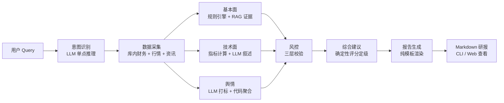

# fin_analyst_crew · 多维投研智能体系统

> [!WARNING]
> 本项目仅供学习与研究，**不构成任何投资建议**。全部输出由程序化规则与大语言模型自动生成，可能存在错误、滞后或幻觉。请完整阅读文末[免责声明](#免责声明)后再使用本项目。

基于 CrewAI Flows 的 A 股多维投研系统：以**确定性 DAG** 编排八个节点，数值与方向判定全部来自规则引擎与程序化计算，大语言模型只负责节点内的叙述组织——结论可复现、过程可回溯（全链路 trace 记账）。检索侧为 PostgreSQL + pgvector 上的混合召回 RAG，为基本面分析提供年报证据引用。

## 系统架构



- **编排原则**：LLM 不做任务拆分、不改写数值结论；凡是需要可复现的判定（方向、评级、评分、纪律条款）全部由代码产出，LLM 仅在其边界内组织语言，且任一 LLM 调用失败均降级为规则兜底，链路不中断。
- **检索链路**：向量召回（halfvec + HNSW）与关键词召回（jieba + GIN）两路并行 → RRF 排名融合 → 精排（可开关）→ 子块命中后凭父块编号回取整节原文（Small-to-Big），证据引用可回链原文。
- **风控三层**：组合规则命中 → 财务异动行业阈值 + 数据完整性 → 幻觉候选标记（只标记不定案）。

## 核心特性

- **混合检索 RAG**：半精度向量（`halfvec` + HNSW）与中文关键词（jieba 预分词 + tsvector + GIN）双路召回，RRF 融合，父子分块（小块检索、大块生成），内容哈希幂等重建
- **规则引擎研判**：财务指标方向/持续性/幅度的组合规则判定，命中规则的含义与风险警告取自配置原文，LLM 无权改写
- **三层风控**：组合规则、财务异动阈值（行业可配）、数据缺失显式声明、幻觉候选标记——采集缺口自动进入风险清单与局限性声明
- **综合建议**：跨维度确定性评分 → 评级 / 操作时机 / 关注信号 / 纪律提醒，逻辑可回溯
- **双入口**：CLI 直出结论；FastAPI 服务（同步研判接口 + 报告中心网页）——编排层缺依赖时报告查看仍可用

## 技术栈

| 层 | 选型 |
|---|---|
| 编排 | CrewAI Flows（确定性 DAG） |
| 模型 | 火山方舟（doubao 系列对话 / 嵌入 / 精排） |
| 存储 | PostgreSQL + pgvector（`halfvec` HNSW + tsvector GIN） |
| 数据 | akshare / 东方财富资讯接口 / 上交所年报 PDF |
| 服务 | FastAPI + Uvicorn + 原生 HTML/JS 前端 |
| 解析 | PyMuPDF / pdfplumber |

## 快速开始

> 要求 Python 3.11–3.12、本地 PostgreSQL（仓库提供 docker-compose）。

```bash
# 1. 安装依赖
pip install -e .

# 2. 配置密钥
cp .env.example .env   # 填入 ARK_API_KEY、VIKINGDB_AK/SK、POSTGRES_PASSWORD

# 3. 启动数据库并初始化表结构
docker-compose up -d
python scripts/ingest/init_db.py
```

数据准备（需自备年报 PDF 与行情数据授权）：

```bash
python scripts/fetch/fetch_structured.py     # 行情 / 财务 / 估值快照
python scripts/parse/parse_reports.py        # 年报 PDF → 结构化块
python scripts/normalize/normalize_reports.py
python scripts/chunk/chunk_reports.py        # 标题感知父子分块
python scripts/embed_store/embed_store_chunks.py  # 嵌入入库 + 建索引
```

运行：

```bash
# CLI：单次研判
python src/main.py "对招商银行 2024 年做完整研判"

# 服务：研判接口 + 报告中心（http://127.0.0.1:8317）
python src/api.py
```

## 目录结构

```
├── configs/                        # 配置中心（改参数不改代码）
│   ├── config.yaml                 #   主配置（服务 / 数据库 / 压缩 / 幻觉开关）
│   ├── rag.yaml                    #   检索链参数（嵌入 / 召回 / 融合 / 精排 / 切块）
│   ├── report_template.md          #   研报 Markdown 模板
│   └── rules/
│       ├── analysis_rules.yaml     #     组合研判规则 + 行业异动阈值
│       └── technical_rules.yaml    #     均线 / 量比 / 动量等技术参数
├── prompts/                        # 提示词（三段式：标题 / system / user）
│   ├── orchestrator_intent.md      #   意图识别
│   ├── fundamental_agent.md        #   基本面叙述
│   ├── technical_agent.md          #   技术面叙述
│   ├── sentiment_agent.md          #   舆情打标
│   ├── risk_hallucination.md       #   幻觉候选标记
│   └── advice_agent.md             #   综合建议核心逻辑叙述
├── src/
│   ├── agents/
│   │   ├── orchestrator/           #   Flow 编排 + 意图识别 + 全局状态
│   │   ├── collector/              #   数据采集（池校验 / 财务 / 行情 / 资讯）
│   │   ├── fundamental/            #   基本面（规则引擎 + RAG 证据）
│   │   ├── technical/              #   技术面（指标计算 + LLM 叙述）
│   │   ├── sentiment/              #   舆情（LLM 打标 + 代码聚合）
│   │   ├── risk/                   #   三层风控（规则 / 阈值 / 幻觉标记）
│   │   ├── advice/                 #   综合建议（确定性评分定级）
│   │   └── report/                 #   报告渲染（单写者）
│   ├── core/                       #   配置加载 / 日志 / trace 记账 / 提示词装载
│   ├── db/                         #   连接 + 表结构（结构化层 / RAG 检索层 / 索引）
│   ├── llm/                        #   对话 / 嵌入 / 精排客户端（限流、重试、契约校验）
│   ├── rag/                        #   混合检索器 / 证据压缩器 / 检索配置
│   ├── rules/                      #   规则引擎（方向 / 持续性 / 幅度 / 组合判定）
│   └── web/                        #   报告中心前端（原生 HTML/JS）
├── scripts/                        # 离线管道与评测
│   ├── fetch/                      #   行情 / 财务 / 估值快照拉取
│   ├── parse/                      #   年报 PDF → 结构化块
│   ├── normalize/                  #   块清洗与章节路径归一
│   ├── chunk/                      #   标题感知父子分块
│   ├── embed_store/                #   嵌入入库 + 延迟建索引
│   ├── ingest/                     #   数据库初始化
│   └── eval/
│       └── retrieval/              #     检索三路归因评测 + 金标集 + 成本/保真检查
├── data/                           # 数据目录（raw / parsed / processed，体量不入库）
├── docker-compose.yml              # PostgreSQL（pgvector）一键启动
└── pyproject.toml
```

## 评测

仓库内置小型自建金标集与评测脚本（[scripts/eval/retrieval](scripts/eval/retrieval)），提供向量 / 关键词 / 混合三路归因与 Hit@k、Recall@k、Precision@k、MRR 指标，用于检索参数变更时的回归监控；另有成本对照与数值保真检查脚本。因金标规模有限，本页不展示结论性数字，结果以本地 JSON 存档供横向对比。

## 免责声明

**请在使用前完整阅读本节。下载、克隆、复制或以任何方式使用本项目，即视为您已阅读、理解并同意以下全部条款。**

1. **项目性质**：本项目是一个以学习与研究为目的的技术演示系统，用于展示多智能体编排、检索增强生成（RAG）与规则引擎等工程实践，不构成任何金融产品或证券投资咨询服务，亦不属于持牌证券经营机构发布的研究报告。
2. **非投资建议**：本项目输出的全部内容——包括但不限于"综合评级""操作时机""关注信号""风险清单"等——均为程序化规则与大语言模型在特定数据快照下自动生成的参考信息，不构成买卖任何证券、基金或其他金融产品的建议、要约或要约邀请。任何投资决策应基于您独立的专业判断，并咨询持牌投资咨询机构。
3. **信息不作保证**：本项目依赖的第三方数据源（行情接口、资讯接口、公开年报等）不存在任何准确性、完整性、及时性或适用性的保证；数据可能缺失、延迟、错误或已失效。
4. **AI 生成内容风险**：系统中由大语言模型生成的叙述性文本可能包含事实错误、幻觉、遗漏或过时信息。尽管本项目设置了证据核验、降级兜底与风险标记机制，仍无法完全消除上述风险，相关输出不应被作为事实依据使用。
5. **责任限制**：在法律允许的最大范围内，项目作者与贡献者不对因使用、误用或无法使用本项目而产生的任何直接、间接、偶然、特殊或后果性损失（包括但不限于投资损失、数据损失、经营损失）承担责任。您基于本项目输出所做出的任何行为及其后果，由您自行承担。
6. **合规使用**：您应遵守所在司法辖区的法律法规以及数据来源方的服务条款；不得将本项目或其输出用于任何非法用途，或用于向第三方提供投资咨询等需要相应资质的业务。
7. **条款变更**：本免责声明可能随项目演进更新，更新后继续使用即视为接受变更。

若您不同意上述任何条款，请立即停止使用并删除本项目。

